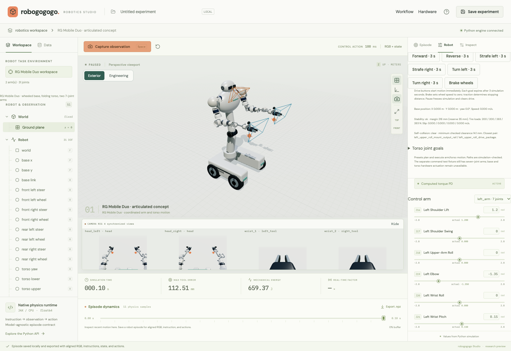
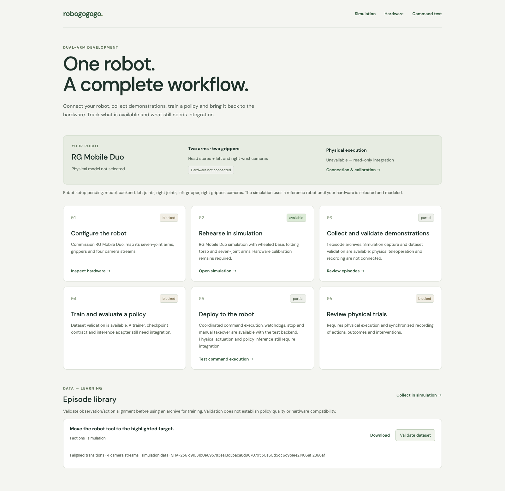

# robogogogo

An experimental robotics workbench investigating **which simulation errors matter
when collecting demonstrations for robot learning**. The initial research
framework compares controlled camera, lighting, contact-friction, and command-delay
errors using Panda Lift in robosuite/MuJoCo, with matched interaction budgets and
separate selection and held-out evaluation. It includes a visual imitation
baseline and a trainer interface. **This research implementation has not yet been
validated or evaluated; it establishes no VLA or real-robot transfer result.**
See the [research question, protocol, and usage](docs/research.md).

The original browser Studio provides a local workbench for **RG Mobile Duo**:
a wheeled robot concept with a folding torso, two seven-joint arms, head stereo
cameras, and a camera on each wrist. Python/JAX simulates the robot; a
Next.js/Three.js Studio lets you inspect
its mechanism, plan movement, and record aligned visual demonstrations.



Use it to explore the robot's geometry and dynamics, rehearse guarded motions,
collect RGB/depth and joint-state transitions, or develop integrations against
explicit robot and dataset contracts. You can start entirely in simulation;
neither a physical robot nor a GPU is required.

**Studio status:** simulation and dataset validation work today. The reach
baseline is rule-based. Training, learned checkpoint inference, physical command
execution, and real-robot evaluation still require integration. The mechanical
design is illustrative; physical hardware has not been commissioned.

## Research paper

**[Read the paper (PDF)](paper/robogogogo.pdf)**:
*Robogogogo: An Early Robot Simulation Environment for Demonstration Data
Collection*, by Tian Shi (Exciton Research LLC) and Ping Wang (Department of
Computer Science, Stevens Institute of Technology).

The early paper describes the original environment, data representation,
preliminary geometric analysis, and research directions for VLA policies and
learned world models. It does not report results from the new controlled study.
[LaTeX sources, references, figures, and build instructions](paper/)
are included in this repository.

## Install and run

The standard CPU setup targets **Apple Silicon macOS** and **Linux x86_64/ARM64**.
Install Python 3.11+ (3.12 is used in CI), Node.js 22.6+ (an LTS release), npm, and
Git, then:

```sh
git clone https://github.com/Exciton-Research/robogogogo.git
cd robogogogo
bash scripts/setup.sh
.venv/bin/robogogogo-studio
```

Open **[http://127.0.0.1:8765](http://127.0.0.1:8765)**. The first startup compiles
JAX kernels and can take a while. Wait for application startup to complete. Stop
the server with Ctrl+C.

The setup script creates a local `.venv`, installs Python dependencies, builds
Studio from the npm lockfile, and checks one guarded simulation step. Rerun it
with the same options after updating the checkout. It does not install system
packages or change global Python/npm configuration.

See the **[installation guide](docs/installation.md)** for macOS/Linux prerequisites,
manual installation, headless use, upgrades, and troubleshooting. Intel macOS is
outside the standard setup because current JAX CPU wheels target Apple Silicon.

## Your first session

1. Open **Simulation** from the workflow overview. The robot starts paused.
2. Orbit and zoom the 3D view. Choose **Engineering** to inspect the internal
   packaging. The **Robot** panel controls whole-body reaching, postures, wheels,
   and individual arm goals.
3. To collect a demonstration, switch to **Episode** and choose **Start new
   episode**. This resets the robot and creates a fresh recording.
4. Choose **Execute + capture next RGB**. The default zero action records a valid
   observation/action/next-observation transition. Try **Run rule-based reach**
   for a reach demonstration using simulator target positions.
5. Choose **Save & export episode**, return to **Workflow**, and select
   **Validate dataset** in the episode library.

Follow the **[step-by-step Studio guide](docs/getting-started.md)** for motion
controls, camera capture, recording, exports, and the command test console.
Debug movement controls end the current episode; start a new one before recording
again.



## What is implemented

- **One versioned robot:** 31 simulation coordinates, two seven-joint arm command
  groups, camera mounts, actuator catalog geometry, and explicit joint ordering.
- **Simulation:** coupled JAX dynamics, swerve steering, tire slip/friction,
  support-margin monitoring, self-collision checks, and bounded arm/torso detour
  planning. Whole-body reaching coordinates the base, torso, and both arms toward
  a shared hand-center target while preserving final hand spacing.
- **Data:** synchronized simulated RGB, optional renderer ground-truth depth,
  language instructions, joint states, and explicit joint-delta actions. Action
  sources remain labeled as manual, rule-based, reference, or policy.
- **Learning inputs:** archive alignment, robot identity/revision, joint ordering,
  camera consistency, and SHA-256 validation. An archive is an input to an external
  trainer; this repository does not train a model.
- **Hardware observations:** read-only ROS 2/SDK telemetry, measured camera
  calibration, acquisition-time joint synchronization, moving-base localization,
  and scene memory.
- **Command lifecycle tests:** opt-in coordinated arm/gripper commands with
  ownership leases, watchdogs, stop, and takeover in a deterministic test backend.
  This backend is independent of both simulation and physical telemetry.

## Data and persistence

One server is one shared workspace, including across browser tabs. The default
storage location is `runs/studio/`, relative to the directory where you launch it.
Choose a stable directory explicitly when needed:

```sh
.venv/bin/robogogogo-studio --projects "$HOME/robogogogo-runs"
```

- **Save experiment** writes a JSON state checkpoint. Loading it pauses the robot
  and starts a new recording; it does not restore a visual episode or motion queue.
- **Export .npz** saves the numerical trajectory and model parameters, without RGB.
- **Save & export episode** writes `episodes/<uuid>.zip` and its library summary.
  ZIPs contain aligned observations/transitions, PNG frames, captured depth, and
  physics parameters. Capture the final observation before validating API-created
  episodes; the browser action button does that automatically.

Back up the project directory separately. Git ignores local recordings and
generated UI assets. Existing archives are never silently relabeled when robot
geometry or its revision changes.

## Headless and development use

For the Python engine without Studio or Node.js:

```sh
bash scripts/setup.sh --headless
.venv/bin/python -m robogogogo --headless --steps 100 --export /tmp/mobile-run.npz
```

For development, install test tools and run the checks:

```sh
bash scripts/setup.sh --dev
.venv/bin/pytest -q
.venv/bin/ruff check src tests examples scripts
.venv/bin/ruff format --check src tests examples scripts
npm test --prefix studio
npm run format:check --prefix studio
npm run typecheck --prefix studio
npm run build --prefix studio
```

See **[development and verification](docs/development.md)** for the two-server
development loop, package ownership, targeted tests, and screenshot regeneration.

## Guides

- [Documentation index](docs/README.md)
- [Controlled simulation-error research](docs/research.md)
- [Install on macOS or Linux](docs/installation.md)
- [Studio walkthrough](docs/getting-started.md)
- [Architecture and workflow layers](docs/platform.md)
- [Robot design and planning](docs/mobile-robot-design.md)
- [Command execution test console](docs/command-execution.md)
- [Measured hardware perception and ROS integration](docs/hardware-perception.md)
- [Physics conventions and algorithms](docs/physics.md)
- [Development, tests, and screenshots](docs/development.md)

## Scope and limitations

RG Mobile Duo is the only supported product robot. Alternate robot selection,
arbitrary URDF import, fixed-base task routes, and standalone structural lab are
not exposed in Studio. Historical numerical fixtures remain under `tests/fixtures`.

Planning uses conservative self-collision proxies and support sampling with
runtime guards. It does not avoid external obstacles or model payload planning,
terrain, suspension, roll/pitch impacts, or rollover. Fingers are visual geometry;
the numerical grasp/contact/material regressions are not integrated as physical
grasping on this robot. Tire parameters, inertias, geometry, and limits still need
measurement. Nothing in this workbench certifies hardware readiness.

Physical deployment requires selected actuators, measured limits and calibration,
a commissioned command adapter, physical stop integration, and real evaluation.
ROS and SDK adapters currently remain read-only.

## License and contributions

The project's original source code, documentation, screenshots, and robot design
assets are licensed under [Apache-2.0](LICENSE). See [NOTICE](NOTICE) for the project
notice and [THIRD_PARTY_NOTICES.md](THIRD_PARTY_NOTICES.md) for Studio's upstream
software and font licenses. Third-party materials retain their own licenses;
vendor product references do not grant rights to vendor trademarks or CAD.

See [CONTRIBUTING.md](CONTRIBUTING.md) for bug reports and pull requests, and
[SECURITY.md](SECURITY.md) for vulnerability reporting. Redistribution must retain
the applicable license texts and notices. Simulation and conceptual design assets
do not certify a physical robot or establish hardware readiness.
