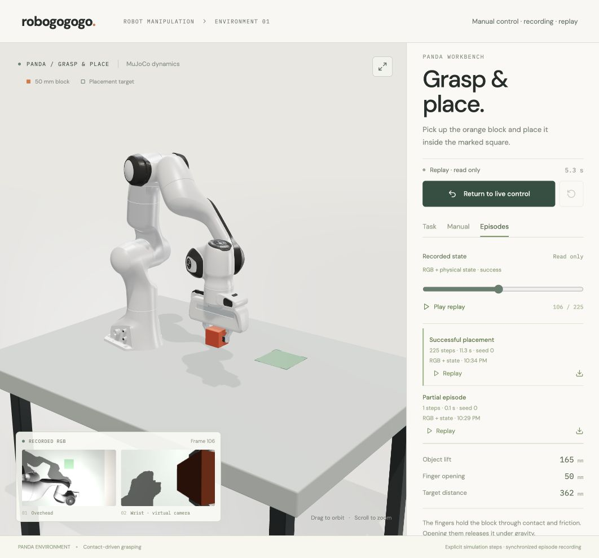

# robogogogo documentation

Start with the **[Panda workbench guide](demo.md)**. It covers eight textured YCB
scans, individual-object loading, named-target collection from a shared table,
manual control, recording/replay, and the policy interface for a future VLA.
The current collector uses known scene identities and poses; camera-based
recognition and learned control are not implemented.

## Start here

1. **[Installation](installation.md):** macOS/Linux setup, asset downloads,
   native rendering, headless use, and troubleshooting.
2. **[Panda workbench](demo.md):** load the object library, collect a target,
   continue with another target, record/replay, and connect an external policy.
3. **[Development](development.md):** Python/TypeScript ownership, local preview,
   packaging, and verification commands.

## Earlier RG Mobile Duo workspace

The original illustrative mobile dual-arm workbench remains separate from the
Panda environment. Its dynamics, action convention, and archive format differ.
Launch `robogogogo-studio` and use `/simulation/` or `/workflow/` for these guides:

- **[Studio walkthrough](getting-started.md)** for movement, collection, exports,
  and episode validation in the original workspace.
- **[Platform layers](platform.md)** for robot identity, runtime ownership, and
  the legacy data/command interfaces.
- **[Mobile robot design](mobile-robot-design.md)** for geometry, actuator
  packaging, swerve dynamics, planning, and model limits.
- **[JAX physics](physics.md)** for the original numerical model and conventions.
- **[Command execution](command-execution.md)** for the deterministic command
  backend, ownership leases, stop, and takeover.
- **[Hardware perception](hardware-perception.md)** for read-only measured
  telemetry/calibration integration. Simulation camera presets are not physical
  calibration measurements.
- **[Design iteration reports](validation/)** for historical robot revisions.
  These reports are not Panda task evaluations.

## Other material

- **[Contributing](../CONTRIBUTING.md)** and **[security](../SECURITY.md)** cover
  contribution guidelines and the local deployment boundary.

Object data and recordings stay in ignored local caches. Training, learned VLA
inference, room imports, and physical robot execution require further work.

Research papers, experiment code, and results live in the separate
[excitonresearch-papers repository](https://github.com/raugen-ai/excitonresearch-papers/tree/main/robogogogo).
