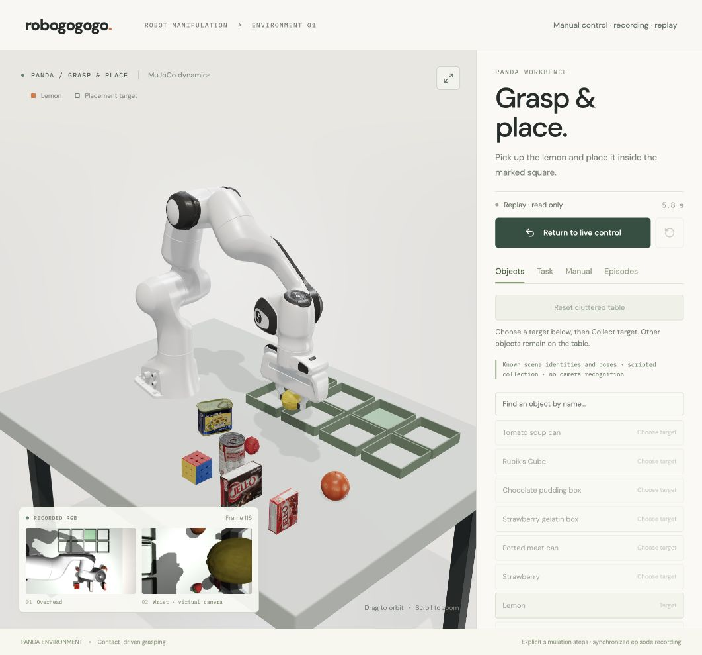

# Panda grasp-and-place environment

One Franka Emika Panda grasps a selected tabletop object, carries it to a marked target,
releases it, and withdraws. The environment provides seeded reset, explicit
stepping, manual control, local episode recording, and read-only replay.
MuJoCo simulates the arm, gripper, object, and table contacts. Three.js displays
the simulated poses using the official robot meshes.

The reference controller uses scripted Jacobian IK with smooth joint targets.
It is not a learned policy or a real-robot result. The selected object has a free joint
throughout the task; it is never attached or welded to the hand. Only reset
writes its initial position.



## Start

```sh
bash scripts/setup.sh
.venv/bin/robogogogo-demo
```

Open [http://127.0.0.1:8765](http://127.0.0.1:8765). For an existing installation:

```sh
.venv/bin/pip install -e '.[studio,demo]'
.venv/bin/python -m robogogogo.demo --setup
npm run build --prefix studio
.venv/bin/python -m robogogogo.demo
```

Setup explicitly downloads pinned official Panda assets into the Git-ignored
`runs/demo/assets/` cache. Requests do not download assets. The standalone server
binds to localhost and serves only the Panda environment. The original RG Mobile
Duo workspace remains available through `robogogogo-studio` at `/simulation/`
and `/workflow/`.

## Object library

The **Objects** tab includes eight textured scans from the
[YCB Object and Model Set](https://ycb-benchmarks.s3.amazonaws.com/index.html):

- **Tomato soup can**, `soup-can` / `005_tomato_soup_can`: about 6.8 × 6.8 × 10.2 cm,
  with an analytic cylinder for collision and an assigned mass of 350 g.
- **Rubik’s Cube**, `rubiks-cube` / `077_rubiks_cube`: about 5.9 × 5.8 × 5.8 cm,
  with a box for collision and an assigned mass of 90 g. It is a single rigid body;
  its faces do not turn.

Additional scans are chocolate pudding and strawberry gelatin boxes, a potted
meat can, a strawberry, a lemon, and an orange. Boxes are oriented upright without
changing their metric dimensions. Fruit and the meat can use MuJoCo convex mesh
collisions; their small concavities are approximated by the convex hull.

The original 50 mm block remains available. Select **Load object** to start a new
task with the chosen object. Pause a reference run and save/discard any recording
before switching. Exit replay before loading another scene.

Setup downloads the eight pinned Google 16k scan archives. Existing installations can
rerun `robogogogo-demo --setup` or use **Download & load** in the Objects tab.
Scene/state requests never initiate downloads. Explicit downloads require network
access; installed objects work offline. Meshes, textures, and provenance manifests
stay under the ignored `runs/demo/assets/objects/` cache, not in Git.

Metric dimensions and UV textures are preserved. Processing centers each mesh,
rotates the toy and boxes upright, and reduces its 4096 px texture to 1024 px. The browser
and native MuJoCo RGB renderer use the same mesh and texture. Browser OBJ export
preserves texture seams and the compiled UV convention.

Collision shapes approximate the scanned can and cube; scanned surface dents and
small toy gaps are not reproduced in the contact geometry. Mass and friction are
assigned simulation parameters, not measured calibration. Imported objects use a
300 N/m gripper tendon servo gain within the upstream force limit so the heavier
can can be held; the original block configuration stays unchanged. Objects stay
free bodies and are never welded to the gripper. The reference controller adjusts
pickup/placement heights to the selected object's size.

Each recording includes the object's identity, dimensions, assigned physical
properties, source, processing notes, and asset digests. Replay loads the recorded
object, including when another object is live, and returning from replay restores
the original live object and physical state. The asset cache must be present.
Old block recordings remain supported.

For Python, install assets once, then choose an object explicitly:

```python
from robogogogo.demo import PandaEnv
from robogogogo.demo.objects import download_object

# Explicit network setup; omit once cached.
download_object("runs/demo/assets", "soup-can")
with PandaEnv(object_id="soup-can") as env:
    observation, info = env.reset(seed=0)
    result = env.step(observation["previous_action"])
```

API routes: `GET /api/demo/objects`,
`POST /api/demo/objects/{id}/download`, and
`POST /api/demo/objects/select` with `{"identifier": "soup-can", "seed": 0}`.
Changing objects is an explicit scene reset. Room imports and arbitrary mesh
uploads are outside this version.

### Cluttered-table collection

Choose **Load cluttered table · 8 objects** to place all eight scans on the same
table. Each has an independent free joint, collision geometry, and texture.
The layout is reproducible by seed, with small bounded position jitter. Shallow
collection cells occupy the other side of the table and contain rounded fruit.

Choose a target by its name in **Objects**, then **Collect target**. The selected
object has its own marked collection cell. After completion, choose another
object to continue from the existing physical scene. Changing targets resets task
bookkeeping and the episode identity; it does not reposition the robot or objects.
Reset restores the complete seeded table. Active recordings must be saved or
discarded before changing targets.

**Current controller:** scripted motion using known scene identities and poses.
Searching the object list is a user interface operation. Camera-based object
recognition is not implemented. The controller compensates for small object nudges
before grasping and for the measured object-to-tool offset before placement.
Other objects remain physical obstacles; this is a bounded tabletop arrangement,
not a general collision-free planner or arbitrary clutter-solving policy.

Clutter success requires the selected object center inside its 13 cm collection
cell (within 6 cm on both horizontal axes), near its resting height, at low speed,
released with an open gripper, previously lifted by at least 95 mm, and clear of
the withdrawn tool. The condition must hold for six control steps. The remaining
success checks match the single-object task below.

`POST /api/demo/objects/select` accepts `clutter: true` with any target identifier.
`POST /api/demo/target` with `{"identifier": "lemon"}` chooses another object in
the current scene. A target change leaves all physical state intact. The scene
state reports every object instance and whether it is at its collection cell.

Clutter recordings use `panda-episode-v2`: they include the scene object list,
active target index, full physical state of all eight objects, actions, and
optional aligned RGB. Replay reconstructs the recorded scene and target, and
returning to live control restores the previous live scene. Single-object v1
archives remain supported.

### Policy / future VLA interface

`PandaPolicy.act(observation, *, instruction)` returns an action with the existing
seven joint targets (radians) and total finger opening (meters). The synchronous
`step_policy(env, policy)` helper executes one policy action through `env.step`,
including its bounds checks. Use `observation_mode="rgb"` for a camera-based
policy. Observations contain proprioception, prior action, time, and optional
RGB arrays; object identities/poses and success diagnostics stay in `info`.
The instruction names the target. Stateful policies should be reset by their
owner when the episode identity changes.

For a separate model process, `GET /api/demo/observation?images=true` returns the
`panda-policy-v1` packet: instruction, episode/session identity, revision,
proprioceptive observation, two PNG images encoded as base64, camera poses/FOV,
action bounds/units/control interval, and a `read_only` flag. It excludes object
positions. Use `images=false` for state-only clients. RGB needs native offscreen
rendering. No clock advances merely by reading an observation.

Send the policy action to `POST /api/demo/step` with the packet's
`expected_revision`; stale actions and actions during replay/reference playback
are rejected. This leaves the environment ready for an external VLA adapter;
no learned model, training implementation, or recognition result is included.

**Asset attribution:** YCB Object and Model Set, Calli et al., Google 16k scans.
The scanned assets are [CC BY 4.0](https://creativecommons.org/licenses/by/4.0/).
Source URLs, credit, license links, modifications, and archive/asset hashes are
retained in each local `object.json` and recorded episode metadata. Product names
identify scanned objects and do not imply endorsement.

## Control one task

- **Reset:** apply the chosen seed and restore the robot and block. Seed 0 uses
  the original placement; other seeds jitter the initial block position within
  a bounded tabletop region. Save or discard an active recording before reset.
- **Run reference task:** execute the scripted grasp-and-place motion. Pause
  freezes simulation and allows manual takeover. Manual action replaces the
  reference controller; its next run plans from the current pose.
- **Manual:** jog the tool by 5, 10, or 20 mm in world coordinates; choose a total
  finger opening from 0 to 80 mm; or hold the current targets for one 50 ms step.
  Each jog spans six control steps (0.3 s); changing the gripper spans ten
  (0.5 s). IK rejects unreachable targets.
- **Record episode:** capture manual, API, or scripted actions. RGB is enabled
  by default. Save retains partial runs; discard deletes the active recording.
  Environment success or termination automatically saves an active recording.
- **Episodes:** replay a saved run, seek to an exact frame, or download its ZIP.
  Replay is read-only and shows stored states rather than re-running actions.
  **Return to live control** restores the pre-replay physical state. A reference
  task that was running before replay returns paused.

Simulation does not advance while idle in manual mode. The reference task and
replay advance only while playing. One server is one shared session across tabs;
manual requests with a stale state revision are rejected.

Drag to orbit, scroll to zoom, and use the frame button to restore the view.
Live overhead and wrist previews use Three.js with camera poses and fields of
view from MuJoCo. Recorded RGB comes from MuJoCo's native renderer, so its
materials and lighting differ from the browser preview. RGB replay displays the
saved PNGs alongside the recorded physical state.

## Python environment

```python
from robogogogo.demo import PandaEnv

with PandaEnv() as env:
    observation, info = env.reset(seed=7)
    action = observation["previous_action"].copy()
    observation, reward, terminated, truncated, info = env.step(action)
```

`PandaEnv` implements the Gymnasium API. Each action is eight absolute position
targets: seven arm joints in radians, followed by total finger opening in meters
(`[0, 0.08]`). Joint bounds come from `env.action_space`; invalid targets are
rejected. Each `step` runs 25 physics steps of 2 ms, giving a 20 Hz control rate.
The default time limit is 800 control steps (40 simulated seconds). Terminated
or truncated episodes require a reset before another action.

The state observation contains `proprio` (25 values: nine joint positions, nine
velocities, tool world XYZ, and tool quaternion XYZW), `previous_action` (8), and
`time` (1, seconds since reset). Block/target coordinates and success diagnostics
are in `info`, not the agent observation. `observation_mode="rgb"` additionally
returns `overhead` and `wrist` uint8 RGB arrays of shape `(144, 240, 3)`.
`render_mode="rgb_array"` supports `env.render()` for the overhead image.

State-only stepping needs no native OpenGL context. RGB observations and
recording require a working MuJoCo offscreen renderer; disable RGB for state-only
recording on systems without one. Browser previews require WebGL. The environment
and renderer belong to a single thread; the server owns them on a dedicated
worker. MuJoCo and Gymnasium are optional `demo` dependencies; the existing JAX
workspace remains separate.

The browser uses `/api/demo/reset`, `/step`, `/manual`, `/command`, `/record`, and
`/replay`. A direct step request contains `{"action": [eight targets]}` and may
include `expected_revision` from `/api/demo/state` to reject stale commands.
These routes control the same live environment, not separate per-client instances.

## Recordings

Archives stay under the Git-ignored `runs/demo/episodes/` directory. Select a
stable location with `robogogogo-demo --recordings /path/to/episodes`.

Each `panda-episode-v1` ZIP contains:

- `episode.json`: task instruction, simulated origin, seed, outcome, model hash,
  pinned model revision, MuJoCo version, timing, action units/bounds, observation
  ordering, camera intrinsics, and camera pose convention.
- `trajectory.npz`: H actions, rewards, termination/truncation flags, and action
  sources; H+1 observations, timestamps, joint states, camera-to-world matrices,
  and native integration states with task bookkeeping. Loading uses no pickle.
- Optional `rgb/overhead/00000.png` and `rgb/wrist/00000.png` sequences: H+1
  frames per camera, captured at the same boundaries as the observations.

Recordings can start partway through a live run. The first observation is the
state at recording start; times retain their offset from the current task episode. Selecting a new target
starts a new task episode without changing physical state.
Manual sources are labeled `manual`, the reference `scripted`, and direct step
requests `api`. Partial and unsuccessful runs are retained when saved. Replay
requires a matching model hash and MuJoCo version. It is state playback, not a
claim of cross-version deterministic re-simulation.

## Single-object completion

Success requires all of the following for six consecutive control steps:

- block center within 35 mm of the destination;
- block height within 8 mm of its resting height on the table;
- translational speed below 20 mm/s;
- open gripper with no finger contact;
- an earlier lift of at least 95 mm above the resting block center;
- tool center more than 120 mm clear of the block.

Reward is 1 on success and 0 otherwise. Success or a block falling below the
workspace terminates the episode; reaching the time limit truncates it. The
reference controller also checks bilateral contact before lift and elevation
after lift/carry. A reference failure pauses its motion and displays the reason;
manual recovery remains possible if the environment has not ended.

The UI reports measured lift, finger opening, and target distance. The motion
uses fixed waypoints: this is one bounded task, without general collision-free
planning, arbitrary object grasping, or a trained recovery policy.

## Model provenance

The robot comes from [MuJoCo Menagerie's Panda model](https://github.com/google-deepmind/mujoco_menagerie/tree/fb36886b3023db08c198264e1e9956ab202c3e3b/franka_emika_panda),
under its upstream Apache 2.0 license. The ignored asset cache retains the source
license, README, pinned revision, and file digests. The browser links to the source
and `/api/demo/license` serves its license. The workbench, block, controllers,
environment API, and UI are project additions. These assets do not imply that we
designed or manufactured the Panda robot.
