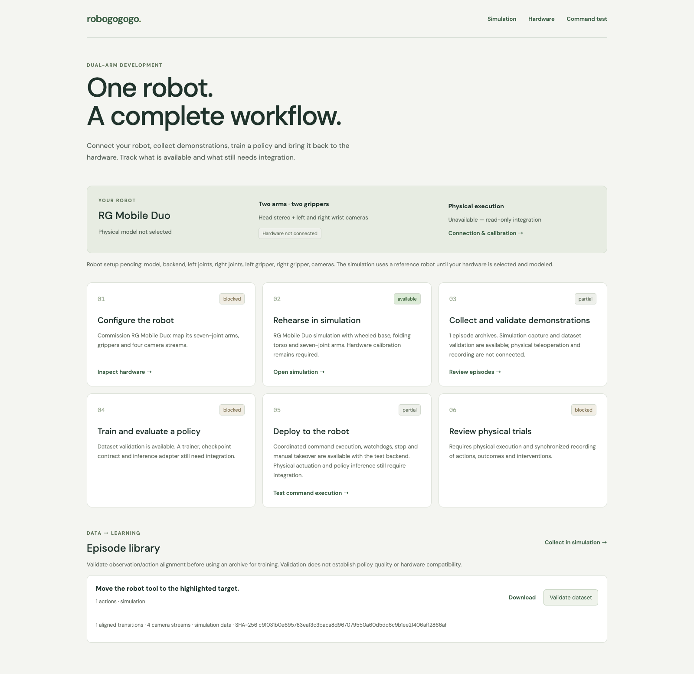
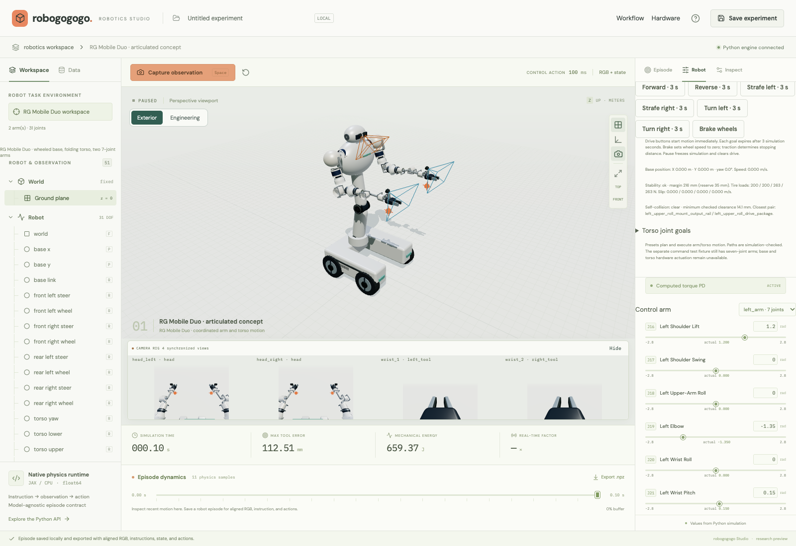
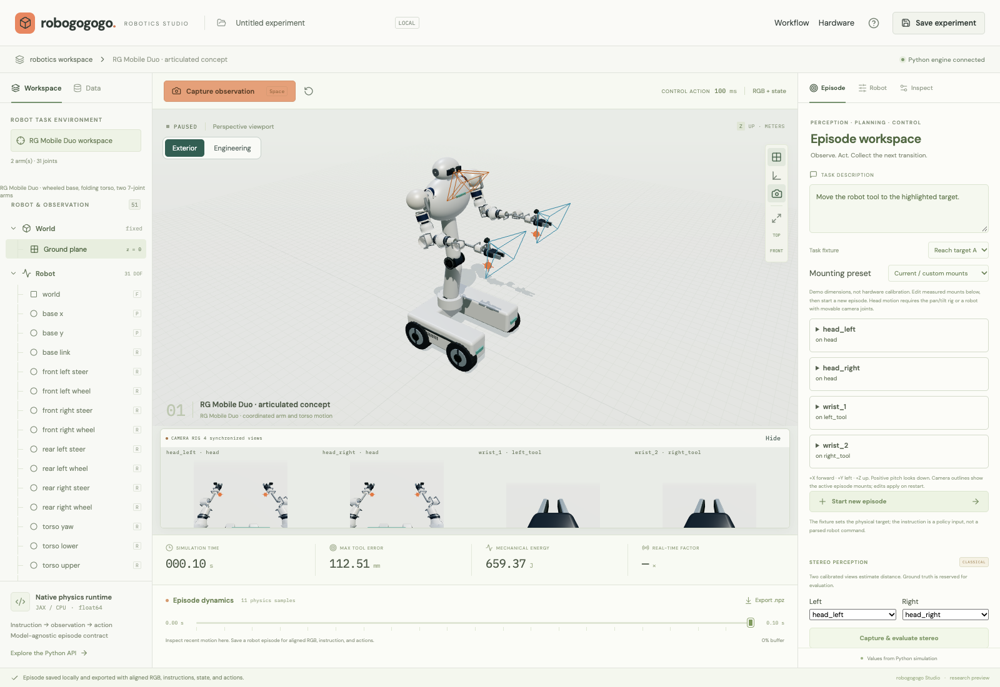
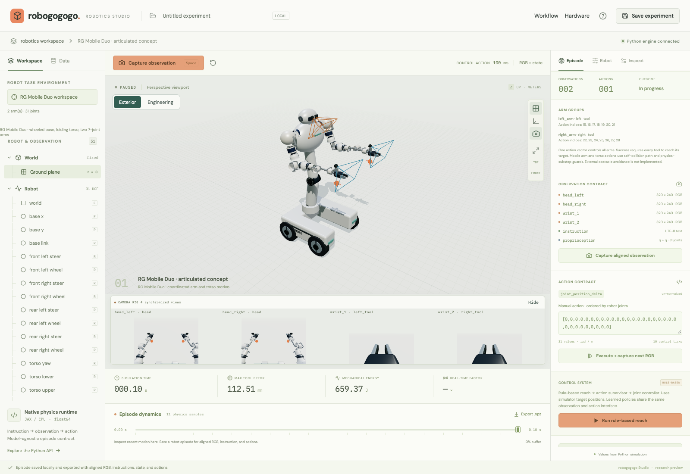
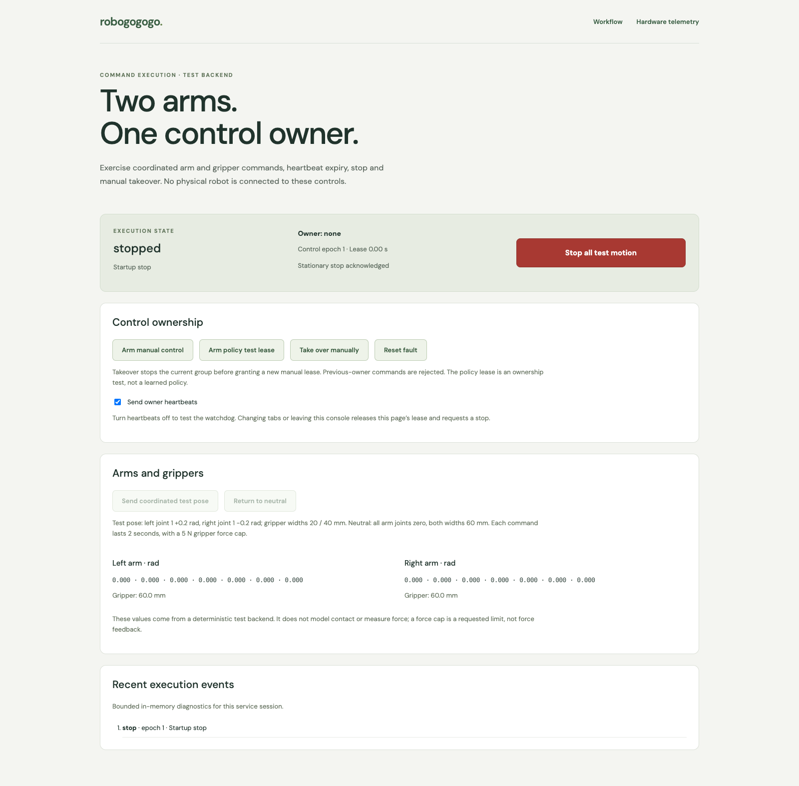
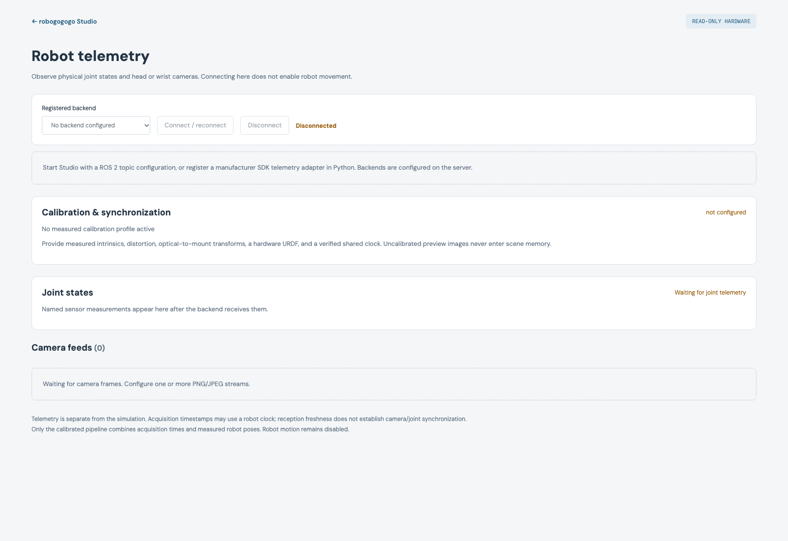

# Your first Studio session

This guide takes you from a paused robot to an exported, validated demonstration.
Complete [installation](installation.md), then start `.venv/bin/robogogogo-studio`
from the repo root and open [localhost Studio](http://127.0.0.1:8765).

## 1. Understand the workspace

The landing page is a workflow overview. It reports what is implemented and what
still needs integration. An unconfigured hardware identity is expected; it does
not block simulation.

- **Simulation** opens the 3D robot, numerical diagnostics, controls, and recording.
- **Hardware** shows registered read-only telemetry backends and measured
  calibration status. A fresh install has none connected.
- **Command test** exercises a separate arm/gripper test backend when explicitly
  enabled. It does not move the simulated robot or physical hardware.
- **Episode library** lists locally saved archives and validates them for learning
  input. Validation does not train a model.



One Python server owns one shared workspace. Multiple tabs share its robot state,
active episode, and projects. When the last simulation WebSocket disconnects,
the server pauses simulation. Keep a single tab open while learning the controls.

## 2. Inspect the robot

Open **Simulation**. Wait for **Python engine connected**. The model starts paused
in its standing pose, with head stereo and two wrist camera previews.



- Drag to orbit the perspective view; scroll to zoom. Use the viewport's top/front
  controls or press **F** to frame the robot.
- Switch **Exterior / Engineering** to inspect the shell or internal packaging.
- Select a link in the tree or click the robot to inspect it. **Inspect** shows
  state and joint details; **Robot** exposes movement controls; **Episode** records
  visual transitions.
- Camera previews are robot-mounted sensor views. Orbiting the main viewport does
  not change their calibrated relative mounts or recorded viewpoints.
- Time, maximum tool error, mechanical energy, and real-time factor come from the
  Python simulation. The timeline retains the most recent 600 browser snapshots;
  numerical trajectory recording has a separate 18,001-sample cap, including its
  initial state.

## 3. Try a guarded motion

Use the **Robot** tab before starting an episode you intend to keep. These debug
controls invalidate the active visual episode.

### Postures and joints

Choose **Move to standing**, **Move to low**, or **Move to reach**. A successful
request plans and starts a path. **Pause motion** freezes time and keeps the arm
queue; **Resume simulation** continues it. **Cancel plan** releases the queue and
holds the current joint position as the controller goal. Reset a failed simulation
with **Reset robot** before moving again.

Arm controls select a seven-joint group. Adjust its values, review the pose draft,
then choose **Move arm**. The shared torso uses **Torso joint goals** and **Move
torso**. Planning may reposition both arms and the torso to find a detour. A draft
is a kinematic preview; the actual movement still has to pass planning and runtime
checks. A rejected goal leaves the current goal in place.

### Wheels

Wheel buttons command body-frame forward/reverse, strafe, or yaw for three
simulation seconds. They start immediately. **Brake wheels** requests zero drive
velocity; traction determines how the base stops. **Pause motion** freezes time
and clears the drive lease. Wait for the robot to settle before planning a new
arm/torso motion. Driving is locked while an arm/torso plan owns the robot.

### Whole-body reaching

Set the world-frame X/Y/Z coordinates of the midpoint between the hands under
**One target. The whole robot.**, then choose **Reach with whole body**. **Use
current hands** fills the current midpoint. The planner coordinates wheels,
torso, and both arms while preserving final hand spacing. This is a local
position-only reach; it does not hold a rigid object or avoid room obstacles.

Self-collision and support guards can reject a motion or freeze a prediction
before committing it. Read the error, reset if required, and choose a smaller or
different target. The displayed safety reserves are simulation assumptions,
not certification for hardware.

## 4. Record your first aligned transition

Switch to **Episode** and choose **Start new episode**. Starting an episode resets
the robot and discards the active unsaved episode; export earlier work first.



1. Enter an instruction such as “Move the robot tool to the highlighted target.”
   Choose reach variant A, B, or C. The variant defines simulator targets; the
   language text is recorded input and is not parsed into a command.
2. Keep the default head/wrist camera preset for the first run. Camera edits apply
   when starting a new episode. They are simulation mounting parameters, not
   measured hardware calibration.
3. Leave the manual delta array at its default zeros and select **Execute + capture
   next RGB**. This captures the current state and images, executes ten control
   ticks, then captures the next observation. A zero command is still a valid
   recorded transition; it is useful for checking the pipeline.
4. Verify the action count increases to one. **Capture aligned observation** (or
   **Space**, outside a text field) captures without executing an action. Repeated
   capture at the same state updates the latest images instead of appending a
   duplicate observation.
5. Choose **Save & export episode**. The server saves the archive and the browser
   downloads a ZIP. Start a new episode to collect another independent run.



The manual action is a 31-value `joint_position_delta` array ordered by
`episode.action_spec.names`, in radians/meters, without normalization. The server
clips deltas to the action limits and joint bounds, then checks the path. Base,
steering, and wheel deltas cannot be used to drive the mobile robot through this
endpoint; use the separate debug drive controls, which end the current episode.

For a longer demonstration, start a new episode and select **Run rule-based reach**.
The collector repeatedly captures, proposes joint deltas from simulator targets,
executes, and captures again. **Stop after current action** stops after the current
transition completes. This is privileged, rule-based IK; it is not learned VLA
inference and does not guarantee that every target succeeds.

Do not switch to robot debug controls during collection. If another client changes
the state during capture, the server rejects stale observations and asks for a
fresh capture. Each action must reference the latest observation. Near the physics
recording cap, the server rejects an action that cannot be fully recorded before
changing the state.

## 5. Validate and read the archive

Return to **Workflow**, find the episode, and choose **Validate dataset**. A valid
result reports aligned transition count, camera count, simulation provenance,
and a SHA-256 digest. The saved ZIP remains available from **Download**.

The validator checks the supported robot identity/revision and exact joint
ordering, as well as transition times, dimensions, and camera consistency. An
observation-only archive cannot be a training dataset. API callers must capture
the next observation after their final action; otherwise the transition is
incomplete and validation fails. Saving an incomplete recording for inspection
is allowed.

Read an exported episode programmatically:

```python
from robogogogo.learning.datasets import inspect_dataset
from robogogogo.data.datasets import iter_transitions

path = "runs/studio/episodes/<your-episode-uuid>.zip"  # Use an actual saved path.
report = inspect_dataset(path)
print(report["transitions"], report["sha256"])
for transition in iter_transitions(path, include_ground_truth=True):
    print(transition.observation.time, transition.action, transition.source)
```

Archives include `episode.json`, camera PNGs under `frames/`, captured float32
depth under `depth/`, and `physics.npz`. Depth is renderer ground truth and is
labeled privileged; it is not a real depth measurement. Images are returned as
PNG bytes so downstream trainers choose their own preprocessing. Training,
checkpoint formats, dataset splits, and inference adapters remain external work.

## 6. Save a setup or numerical run

These are separate from visual episode export:

- **Save experiment** (Cmd/Ctrl+S) writes a local JSON checkpoint with robot state,
  goals, targets, camera configuration, friction, and simulation time. Finish or
  cancel a planned motion before saving. Load it from the **Data** sidebar. It
  restores paused and starts a new trajectory/episode rather than restoring the
  old recording or active queue.
- **Export .npz** saves numerical history and model arrays. It includes no camera
  PNGs. Mobile trajectory metadata identifies the robot and revision.
- The browser timeline is a recent-motion viewer; moving the slider is not an
  action replay or a way to resume dynamics from a historical state.

By default checkpoints and episodes live under `runs/studio/`. Use `--projects`
to keep them elsewhere. Back up this directory; it is ignored by Git.

## 7. Exercise command ownership without hardware

Stop the server and restart with the opt-in test backend:

```sh
.venv/bin/robogogogo-studio --test-execution
```

Open **Command test** from Workflow.



1. Choose **Arm manual control**, then **Send coordinated test pose**. Both
   seven-joint arms and both grippers share a two-second trajectory.
2. Choose **Stop all test motion**. This revokes the lease and requests a fresh
   stationary acknowledgement; grippers hold their width.
3. Arm a policy test lease, send a pose, and select **Take over manually**. The
   old group stops before the new manual lease is granted.
4. Disable **Send owner heartbeats** to test expiry. The one-second lease expires
   and latches a fault. Choose **Reset fault**, then arm again to continue.

This deterministic backend has no contact or force sensing. Its state does not
move the JAX robot. See the [execution guide](command-execution.md) for limits,
API payloads, failure behavior, and adapter responsibilities.

## 8. Understand the hardware screen



An empty/disconnected screen is correct on a fresh install. `--robot-profile`
loads a deployment identity; it does not register a telemetry backend or enable
motors. ROS/SDK telemetry needs measured calibration, exact stream mappings, and
timestamp synchronization before perception is ready. Follow the
[hardware perception guide](hardware-perception.md) for that integration.
